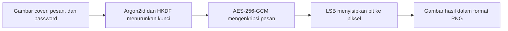
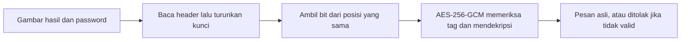

# 🔐 Pixego

### Sembunyikan pesan rahasia di dalam gambar, cukup dengan satu password.

**[🚀 Coba Pixego Sekarang](https://pixego.streamlit.app/)**

---

## ✨ Apa itu Pixego?

Pernah ingin mengirim pesan rahasia, tetapi tidak mau ada orang yang tahu bahwa kamu sedang mengirim pesan rahasia? Pixego dibuat untuk situasi itu.

Pilih sebuah gambar, tulis pesanmu, lalu isi password. Pixego mengenkripsi pesan dengan **AES-256-GCM** dan menyebarkannya ke dalam piksel gambar. Hasilnya tampak seperti gambar biasa, dan hanya bisa dibuka oleh orang yang memegang password yang benar.

Nama Pixego berasal dari kata *pixel* dan *stego* (steganografi).

> ⚠️ **Pixego adalah proyek pembelajaran kriptografi, bukan alat keamanan untuk produksi.** Jangan mengandalkannya untuk melindungi data yang benar-benar sensitif.

## 🎯 Masalah yang Ingin Diselesaikan

Enkripsi biasa menyembunyikan **isi** pesan, tetapi tidak menyembunyikan **keberadaannya**. Data terenkripsi tampak acak dan justru bisa menarik perhatian pihak yang memantau komunikasi.

Steganografi menyembunyikan keberadaan pesan, tetapi metode LSB yang polos punya kelemahan. Westfeld dan Pfitzmann (2000) menunjukkan bahwa beberapa perangkat steganografi populer dapat dideteksi lewat serangan visual dan statistik, termasuk chi-square attack.

Pixego menggabungkan keduanya dan mengujinya secara terbuka:

- **Enkripsi dulu, baru disisipkan**, sehingga kalaupun ada yang mengekstrak bitnya, isinya tetap tidak terbaca.
- **Penyisipan acak berbasis kunci**, sehingga letak bit pesan tidak berurutan dan hanya bisa direproduksi oleh pemilik password.
- **Analisis bawaan** (MSE, PSNR, dan chi-square) agar kamu bisa melihat sendiri seberapa besar gambar berubah dan seberapa mudah ia terdeteksi.

## 🚀 Cara Mencoba

1. Buka **[aplikasi Pixego](https://pixego.streamlit.app/)**.
2. Klik **Coba Sekarang** untuk menyembunyikan pesan, atau buka halaman **Ekstrak** untuk mengungkap pesan.
3. Ikuti langkah di halaman tersebut.

> 💤 Aplikasi gratis di Streamlit bisa tertidur saat lama tidak dipakai. Kalau muncul tombol untuk membangunkannya, klik saja lalu tunggu beberapa saat.

### Contoh penggunaan

| Kamu ingin | Lakukan ini |
|---|---|
| Menyembunyikan pesan di dalam sebuah foto | Buka **Sembunyikan**, unggah foto, tulis pesan, isi password, lalu unduh hasilnya |
| Membuka pesan dari gambar yang dikirim temanmu | Buka **Ekstrak**, unggah gambar PNG atau BMP, lalu masukkan password yang sama |
| Melihat seberapa besar gambar berubah | Buka **Analisis**, lalu lihat nilai MSE, PSNR, dan selisih gambar |
| Membandingkan mode sekuensial dan acak | Buka **Analisis**, lalu pakai bagian **Bandingkan Mode** |

### Tips memakai Pixego

- Pakai **password yang panjang dan unik**. Keamanan pesan sangat bergantung pada kekuatan password.
- Kirim gambar hasil sebagai **file atau dokumen**, bukan sebagai foto lewat aplikasi chat. Banyak aplikasi chat mengompres foto sehingga pesan hilang.
- Jangan **mengubah ukuran, memotong, atau memberi filter** pada gambar hasil.
- Pakai gambar yang **ramai dan bertekstur**. Gambar dengan area warna polos yang luas lebih mudah dideteksi secara statistik.

## 🧭 Isi Aplikasi

| Halaman | Isinya |
|---|---|
| 🏠 **Beranda** | Pengenalan singkat, contoh hasil, dan panduan cara kerja |
| 🙈 **Sembunyikan** | Unggah gambar, tulis pesan, pilih mode, lalu unduh gambar hasil |
| 🔓 **Ekstrak** | Unggah gambar hasil Pixego dan ungkap pesan di dalamnya |
| 📊 **Analisis** | MSE, PSNR, bidang LSB, histogram, dan uji chi-square |
| ℹ️ **Tentang** | Cara kerja, batasan, referensi, dan pengembang |

## ⚙️ Bagaimana Pixego Bekerja

**Saat menyembunyikan pesan**

**Saat mengungkap pesan**

1. **Penurunan kunci.** Password diubah menjadi kunci 32 byte dengan **Argon2id** (lambat dan boros memori agar sulit ditebak dengan brute force). **HKDF-SHA256** lalu memecahnya menjadi dua kunci: satu untuk enkripsi dan satu untuk menentukan posisi penyisipan.
2. **Enkripsi.** Pesan dienkripsi dengan **AES-256-GCM**. Mode ini menghasilkan tag autentikasi sehingga password yang salah atau gambar yang diubah langsung terdeteksi.
3. **Penyisipan.** Bit terenkripsi ditanam pada bit paling tidak signifikan (LSB) piksel. Pada mode **sekuensial** bit ditanam berurutan. Pada mode **acak** urutan kanal diacak dengan keystream AES-CTR dari kunci posisi.
4. **Header.** Header 26 byte di awal gambar menyimpan penanda format, mode, jumlah bit per kanal, salt, dan panjang data. Header juga ikut diautentikasi oleh GCM.
5. **Pengungkapan.** Proses dibalik. Kalau tag GCM tidak cocok, Pixego menolak dan tidak menampilkan apa pun.

### Dibuat dengan prinsip kehati-hatian

- 🔒 **Tidak membuat algoritma sendiri.** Semua primitif kriptografi memakai library yang sudah teruji (`cryptography` dan `argon2-cffi`).
- 🚫 **Tidak mengklaim 100% aman.** Pixego menampilkan batasannya secara terbuka dan menyediakan alat analisis agar kamu bisa menilai sendiri.
- 🗑️ **Tidak menyimpan datamu.** Gambar, password, dan pesan hanya diproses di memori selama sesi dan tidak disimpan ke disk oleh aplikasi.
- 🙋 **Jujur saat gagal.** Password salah, gambar yang sudah dikompres, atau gambar tanpa pesan akan dijawab dengan pesan error yang jelas.

> 🛡️ Aplikasi web ini bersifat publik. Jangan mengunggah data yang benar-benar sensitif ke aplikasi ini.

## 🖼️ Format Gambar

**Gambar cover (input)** boleh PNG, JPG, BMP, dan WebP. Pixego menanganinya secara otomatis:

| Kasus | Perlakuan |
|---|---|
| Foto HP dengan rotasi EXIF | Rotasi diterapkan agar tidak miring |
| PNG transparan | Diratakan di atas latar putih |
| GIF atau PNG palet | Diubah ke RGB, GIF animasi hanya frame pertama |
| Gambar sangat besar | Diperkecil otomatis |
| HEIC/HEIF atau file rusak | Muncul pesan error yang jelas, konversi ke PNG atau JPG dulu |
| Metadata (EXIF, profil warna) | Tidak ikut tersimpan di hasil |

**Gambar hasil (output)** selalu **PNG**. Format lossy seperti JPG dan WebP mengubah nilai piksel sehingga pesan hilang.

Mode acak membatasi ukuran gambar sekitar 8 megapiksel karena boros memori. Untuk gambar yang lebih besar, perkecil dulu atau pakai mode sekuensial.

## 🛠️ Teknologi

**Metode:** AES-256-GCM, Argon2id (RFC 9106), HKDF-SHA256, steganografi LSB (sekuensial dan acak berbasis kunci), pengukuran MSE dan PSNR, serta steganalisis chi-square.

## 📝 Catatan dan Keterbatasan

- Pesan rapuh terhadap kompresi, perubahan ukuran, pemotongan, dan filter gambar.
- Header tidak disamarkan dan parameter Argon2id tidak disimpan di header.
- Hasil chi-square hanya menggambarkan **satu jenis** serangan statistik dan sangat bergantung pada karakter gambar. Lolos chi-square tidak berarti aman dari metode steganalisis lain.
- Data di folder `hasil_contoh` berasal dari gambar sintetis dan hanya bukti bahwa kode berjalan, bukan hasil penelitian.
- Cover berformat JPG punya karakter statistik hasil kompresi yang dapat memengaruhi hasil chi-square.
- Parameter Argon2id perlu disesuaikan dengan rekomendasi terbaru (RFC 9106 dan OWASP) sebelum dipakai di luar pembelajaran.

## 📚 Referensi

- Westfeld, A., & Pfitzmann, A. (2000). Attacks on Steganographic Systems. *Information Hiding (IH 1999)*, LNCS, hlm. 61-76. Springer. DOI: [10.1007/10719724_5](https://doi.org/10.1007/10719724_5)
- Böhme, R., & Westfeld, A. (2004). Exploiting Preserved Statistics for Steganalysis. *Information Hiding (IH 2004)*, hlm. 82-96. Springer.
- RFC 9106 (2021). [Argon2 Memory-Hard Function for Password Hashing and Proof-of-Work Applications](https://www.rfc-editor.org/rfc/rfc9106).
- RFC 5869. HMAC-based Extract-and-Expand Key Derivation Function (HKDF).
- NIST SP 800-38D. Recommendation for Block Cipher Modes of Operation: Galois/Counter Mode (GCM) and GMAC.

## 👩‍💻 Pengembang

- Nama : Kayla Verda Fawnia Heses
- NIM  : A11.2024.15689
- Proyek mata kuliah **Kriptografi**

## 📄 Lisensi

MIT. Lihat file [LICENSE](LICENSE).

---

*Pixego adalah proyek pembelajaran kriptografi, bukan alat keamanan untuk produksi.*

